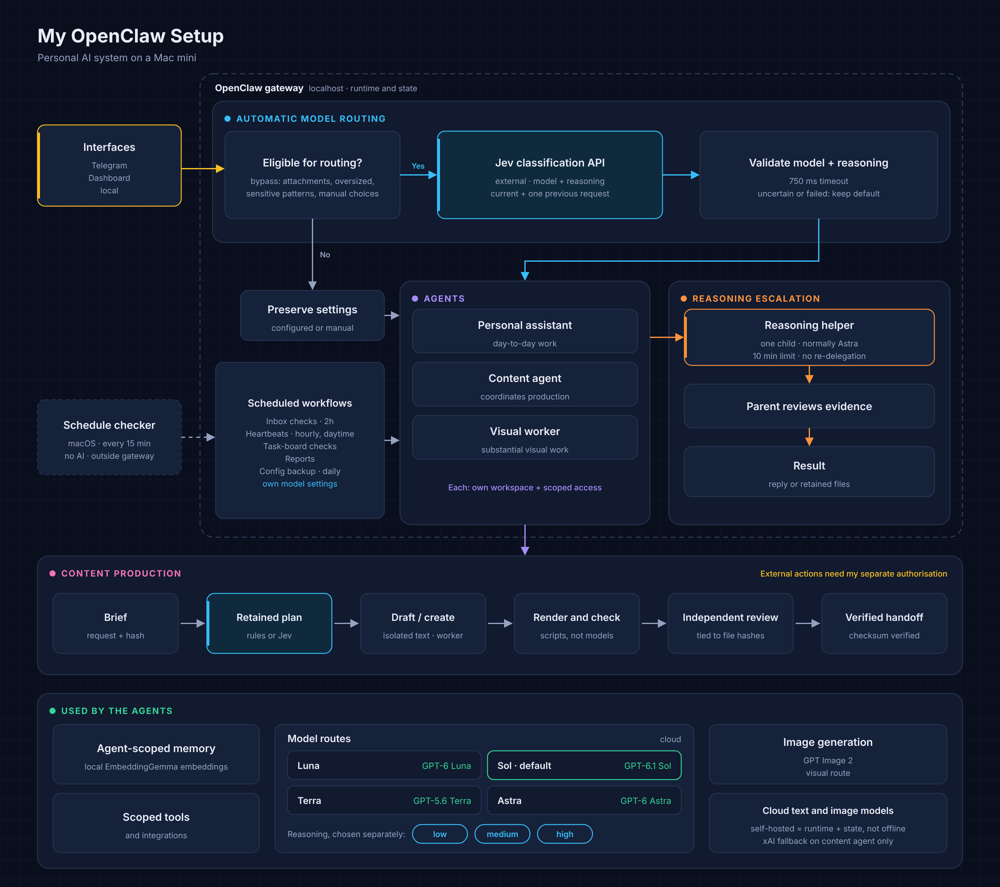
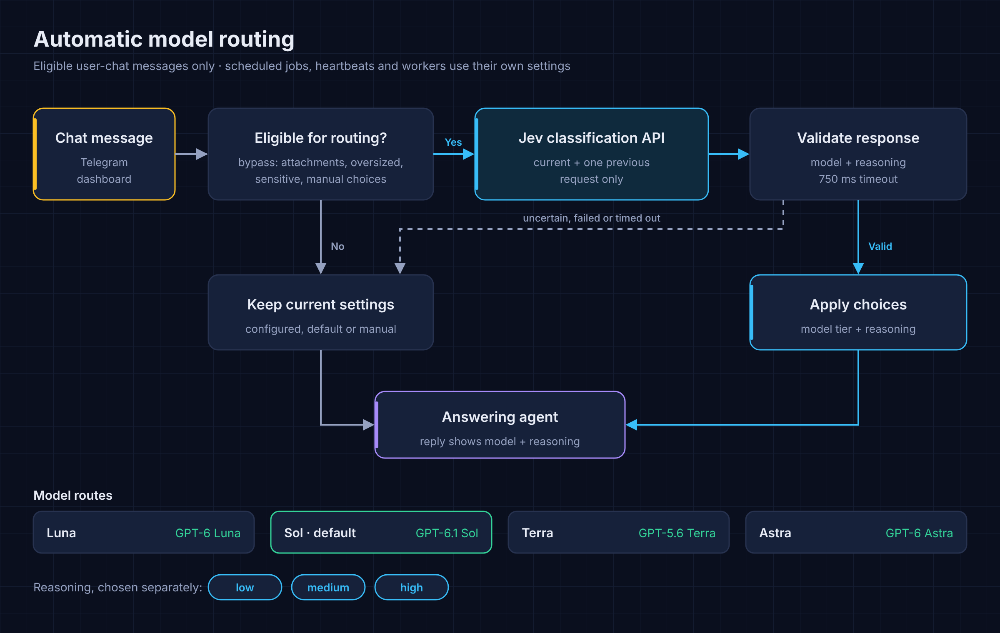
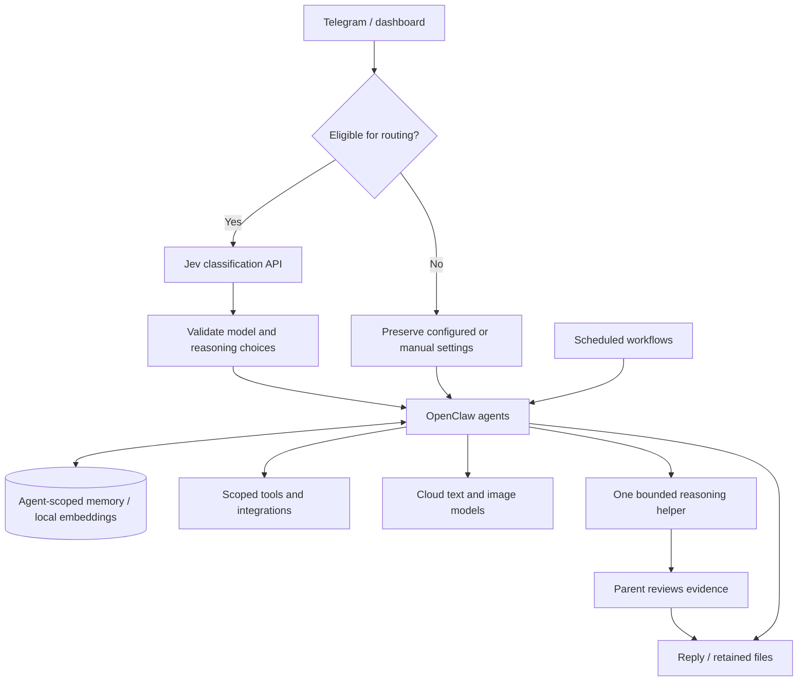

# My OpenClaw Setup

A personal AI system running on a Mac mini, with separate agents, automatic model routing, persistent memory and scheduled workflows.

I use it for research, coding, inbox triage, calendar and notes work, local Mac operations, and producing text and visual content. I talk to it through Telegram or the OpenClaw dashboard, and it can carry out authorised work through tools rather than just suggest what to do.

This is a write-up of my own configuration and extensions. [OpenClaw](https://github.com/openclaw/openclaw) provides the underlying runtime; the routing plugin and workflow helpers described below are additions to my setup. The implementation and account configuration remain private.

## What it does

- **Chooses a model and reasoning effort for eligible chat messages.** Routine requests can use a lighter model; more demanding work can use a stronger one. Manual choices take precedence.
- **Separates responsibilities.** A personal assistant handles day-to-day work. A content agent coordinates production, with a separate worker for substantial visual work. Each has its own workspace and configured access.
- **Keeps useful context between conversations.** Agent-scoped memory stores relevant facts and decisions, with local embeddings for search.
- **Runs scheduled work.** Inbox checks, daytime follow-ups, task-board checks, reports and configuration backups run on their own schedules. Monitors stay quiet when there is nothing actionable.
- **Escalates demanding reasoning.** A parent agent can hand a bounded problem to one stronger reasoning sub-agent, then review its evidence and finish the task.
- **Produces reviewable files.** Content workflows retain briefs, plans, revisions and completion receipts, and check the actual output before handoff.

## How it fits together

The gateway runs as a macOS background service and binds to localhost. Telegram provides a messaging interface, and the dashboard runs locally.

**Self-hosted refers to the runtime and stored state.** Text generation, image generation and Jev classification use external model services, while memory embeddings run locally.

## Automatic model routing

A custom OpenClaw plugin makes two separate decisions before eligible user messages reach the answering agent:

1. Which model tier is appropriate?
2. How much reasoning effort should it use: low, medium or high?

The classifier is [Jev from TypeSafe AI](https://docs.typesafe.ai/models). It selects from choices and criteria I define and returns probabilities and confidence. It does not answer the user, run tools or grant permission to act. The plugin validates its response and decides whether to apply it.

The current model routes are:

| Route | Model | Intended use in this setup |
|---|---|---|
| Luna | GPT-6 Luna | Routine, low-stakes requests |
| Sol | GPT-6.1 Sol | Default conversation, research, coding and tool use |
| Terra | GPT-5.6 Terra | Large synthesis tasks and selected comparisons |
| Astra | GPT-6 Astra | Exceptionally demanding reasoning |

Model selection and reasoning effort are independent. A stronger model does not automatically mean maximum reasoning.

### Boundaries and fallback

Routing applies to supported user-chat paths for the personal and content agents. Scheduled jobs, heartbeats and worker sub-agents use their own configured settings.

Attachments, oversized messages and messages matching sensitive-content patterns bypass classification. A manually selected model is preserved; reasoning selection can still happen independently unless that has also been set manually.

For admitted messages, Jev receives the current request and, when available, one previous admitted user request from the same session. It does not receive the full transcript or stored memory. Short continuations can reuse a recent decision within a 30-minute window.

The request has a 750 ms timeout. Failed or uncertain model decisions retain the capable default; uncertain reasoning decisions retain the existing effort. Successful routing decisions have averaged roughly 0.3 seconds.

Replies carry a compact footer showing the model that completed the turn and the reasoning transition, for example `Sol → Luna | medium → low`. The router's audit log stores prompt hashes and decision metadata rather than raw message text.

## Reasoning escalation

Routing and delegation do different jobs. Routing chooses how the main turn runs. Escalation creates a separate, bounded task for a particularly demanding part of the work.

The escalation policy allows one same-agent reasoning child, normally Astra at medium effort, or high when explicitly requested or justified by the difficulty. It receives a scoped brief and a ten-minute limit, is instructed not to delegate again, and returns evidence and limitations to the parent.

The parent checks the result and completes the original request. Escalation does not provide additional permissions or solve a missing login or approval.

## Content production

The content workflow separates generation, mechanical processing, review and authority for external actions.

**Brief → Retained plan → Draft / create → Render and check → Independent review → Verified handoff**

- **Brief and plan:** retain the request, required deliverables and a hash of the structured brief. Deterministic rules handle known work types; eligible public text briefs can use Jev classification. Private briefs bypass that classifier.
- **Draft or create:** supported text drafts use an isolated completion without tools. Substantial visual work goes to the dedicated worker and image-generation route.
- **Mechanical processing:** scripts handle composition, rendering, dimensions, file hashes and export checks. Exact text-layer revisions can reuse existing artwork without generating another image.
- **Review:** the coordinating agent inspects the finished files independently of the worker. Review records are tied to those exact file hashes, so changing a file invalidates its existing review evidence.
- **Handoff and recovery:** reviewed files can be exported to a private review location, with checksum verification. Retained plans, checkpoints and receipts let stages resume without blindly repeating completed work.

Handoff to the review location is separate from my approval for external actions. Finished files, a passing agent review and a successful upload do not grant that authority.

## Background work and memory

Personal inbox checks run every two hours. They look for new unread messages within a bounded freshness window, deduplicate previous observations and flag messages requiring attention. Routine mail is silent. An unchanged inbox does not need an AI classification call, and the monitor does not send replies or change mailbox flags.

Hourly daytime heartbeats handle current follow-ups without duplicating the dedicated monitors. Other jobs have explicit schedules, including daily configuration backups.

Memory search uses local EmbeddingGemma embeddings. Agent scopes control which stored memory is available; the answering models still run through their configured providers.

An independent macOS schedule checker runs every 15 minutes without an AI call. It checks scheduler responsiveness and overdue work, alerts after repeated bad observations, and reports recovery. It does not restart the service.

## Operating principles

- **Use code for mechanical work.** Models handle interpretation and judgement; scripts handle repeatable file and data operations.
- **Keep authority explicit.** External actions require my authorisation for the specific outcome. Key boundaries are enforced in code: reviews are tied to file hashes, image generation requires a saved plan, and routing exclusions are applied before classification. The remaining boundaries are policy-level rules the agents follow.
- **Minimise unnecessary exposure.** Sensitive-content filters reduce what reaches the routing service, and the audit log keeps hashes rather than message text.
- **Recover from evidence.** Inspect retained files and receipts before retrying work with uncertain completion.
- **Back up configuration carefully.** Configuration exports are redacted and secret-scanned before upload; private conversation history and memory are excluded from that backup.

Automated test suites cover routing exclusions, confidence checks, reasoning selection, retained content plans, generation guards and delivery/recovery behaviour.

## Stack

| Layer | Components |
|---|---|
| Host | Mac mini, Apple M4, macOS, launchd |
| Runtime | OpenClaw, Node.js 24 |
| Custom routing | JavaScript plugin, TypeSafe AI Jev |
| Generation | OpenAI text models, GPT Image 2; configured xAI fallback on the content agent |
| Memory | Local EmbeddingGemma embeddings, persistent memory and SQLite-backed state |
| Workflows | OpenClaw scheduler, JavaScript and Python helpers |
| Interfaces | Telegram, local OpenClaw dashboard |
| Integrations | Browser and Mac tools, email, calendar, notes, Notion, task boards and GitHub |

## Status

This is my daily-use setup, documented from its configuration and local implementation.

The runtime, custom extensions, account access and workflow rules work together. The aim is practical: give the system enough context and tools to finish useful work, keep its authority bounded, and make the result something I can check.

## Limits

It relies on external model services, so it is self-hosted but not offline. Sensitive-content filters are pattern-based safeguards rather than a complete privacy guarantee. The routing latency figure is an observed average, not a guarantee.

## What it taught me

- **Right-size the model.** Matching model and reasoning effort to the task keeps routine work fast and cheap, and saves the strongest models for problems that need them.
- **Keep humans in charge of external actions.** Agents can draft, build and review, but sending, sharing or committing anything outside the system should need an explicit yes.
- **Use code for the mechanical steps.** When scripts handle files, hashes and checks, the output is something a person can verify rather than just trust.

## Diagram (text version)

